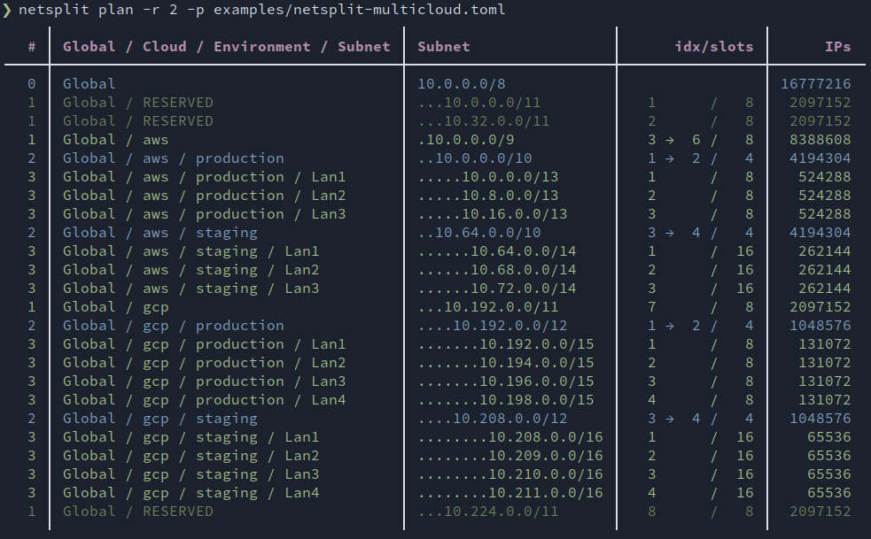

# Netsplit: Slice and dice your IP space

[](https://pypi.org/project/netsplit/)
[](https://github.com/hasiotis/netsplit/actions?query=workflow%3A%22Pull+Request%22)
[](https://github.com/hasiotis/netsplit/blob/main/LICENSE)

Netsplit plans your IP space. Describe a network and its members in a TOML
file, and netsplit splits it into subnets and renders the result as a table.

## Installation

Requires Python 3.10 or newer. Install and update using:
```console
pipx install netsplit
pipx upgrade netsplit
```
or, with pip:
```console
pip3 install --user --upgrade netsplit
```

## Usage

Here is a very simple network plan:
```toml
[netsplit]
  description = "Global / Subnet"
  network = "192.168.0.0/24"

[plan]
  options = { slots = 4 }
  members = ["NetA", "NetB"]
```
We can render it with:
```console
❯ netsplit plan -p examples/netsplit-simple.toml -r 2
     ╷                   ╷                                    ╷               ╷
   # │ Global / Subnet   │ Subnet                             │ idx+ext/slots │ IPs
╶────┼───────────────────┼────────────────────────────────────┼───────────────┼─────╴
   0 │ Global            │ ................192.168.0.0/24     │               │ 256
   1 │ Global / NetA     │ ..................192.168.0.0/26   │   1     /   4 │  64
   1 │ Global / NetB     │ ..................192.168.0.64/26  │   2     /   4 │  64
   1 │ Global / RESERVED │ ..................192.168.0.128/26 │   3     /   4 │  64
   1 │ Global / RESERVED │ ..................192.168.0.192/26 │   4     /   4 │  64
     ╵                   ╵                                    ╵               ╵
```
Here `-p` selects the plan file and `-r 2` also shows reserved slots down to
level 2. With `slots = 4` and only two members, the two unused slots are listed
as `RESERVED`. The `idx+ext/slots` column shows the slot index (plus any
extension) out of the total number of slots.

Run `netsplit plan --help` for all options (`-l` limits the displayed level,
`-k` filters by keyword).

Make sure to check the [examples](examples/) for complex network plans:



## License

Apache 2.0, see [LICENSE](LICENSE).

## Similar projects

* [Visual Subnet Calculator](https://github.com/ckabalan/visualsubnetcalc)
